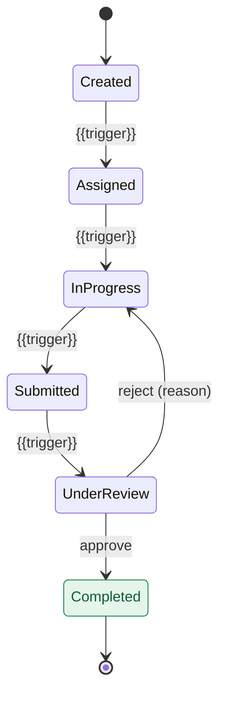
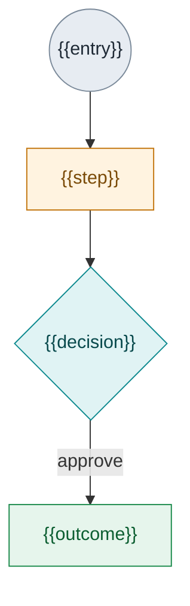
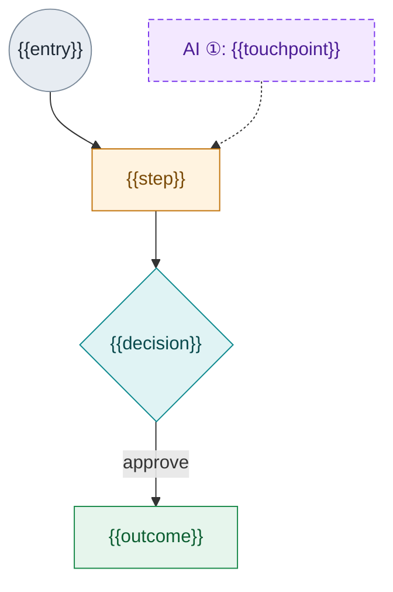

<!--
  DECISION-DOC TEMPLATE (markdown). Renders Mermaid live in Obsidian, GitHub/GitLab,
  and Confluence-with-Mermaid-app. This is the canonical *authoring* source; HTML and
  Confluence are outputs downstream.

  RULES (do not violate — see references/conventions.md):
  - Never fabricate requirements/decisions not in the source. Unknown -> an `Open` row
    with a pointed question. A flagged gap beats an invented answer.
  - Neutral, constructive tone. No commentary on who built something or seniority.
  - "Nothing committed" framing. Convert relative dates to absolute.
  - Color-code diagrams by lifecycle STATUS, not role. Proposed-layer nodes = dashed/advisory.
  - Keep only the sections the source material supports. Delete the rest, including this comment.
-->

# {{TITLE}}

> **Working draft — last edited {{YYYY-MM-DD}}.** Assumptions are flagged; nothing is committed.

{{ONE-LINE DESCRIPTION OF WHAT THIS COVERS.}}

**Status legend:** 🟢 `Decided` aligned at the sync · 🔵 `Assumed` reasonable default · 🟠 `Open` needs a decision · 🟣 `Proposed` offered for review

---

## 01 · Scope & what we're building on

{{What this slice covers and where it sits.}}

**Decided** (confirm in writing before locking):
- {{Decision 1}}
- {{Decision 2}}

> ⚠️ **The hard constraint to design around:** {{the constraint everything assumes}}.

---

## 02 · Roles

| Role | What they do |
|---|---|
| **{{Role}}** | {{responsibility}} |

<!-- Note any base/observer role explicitly. -->

---

## 03 · Permission matrix

✓ = can · ▲ = conditional / needs ruling · · = no.

| Action | {{Role A}} | {{Role B}} | {{Role C}} |
|---|:--:|:--:|:--:|
| {{action}} | ✓ | ▲ | · |

<!-- Flag every ▲ as an Open ruling in §06. -->

---

## 04 · Lifecycle (states)

---

## 05 · Flows

### As-is

### With {{layer}} assist  <!-- omit this whole subsection if there's no proposed layer -->

<!-- Proposed-layer nodes (`:::ai`) are dashed and point INTO the workflow (advisory):
     the layer assists a step, it never advances state on its own. Number touchpoints
     ① ② ③ consistently across diagrams and the cards below. -->

---

## 06 · {{Proposed layer, e.g. AI assist}}  <!-- whole section optional; tag everything Proposed -->

> 🟣 Proposed layer for review — not decided. Principle: **{{layer}} drafts and suggests; a human decides.**

| # | Touchpoint | Where it sits | What it does |
|---|---|---|---|
| ① | {{touchpoint}} | {{step}} | {{behavior}} |

| ID | Requirement | Status |
|---|---|---|
| R-{{LAYER}}-1 | {{requirement}} | 🟣 Proposed |

---

## 07 · First-round requirements

### {{Group}}

| ID | Requirement | Status |
|---|---|---|
| R-{{GROUP}}-1 | {{requirement}} | 🟢 Decided |
| R-{{GROUP}}-2 | {{open question}} | 🟠 Open |
| R-{{GROUP}}-3 | {{reasonable default}} | 🔵 Assumed |

<!-- Repeat a table per lifecycle group: Create, Assign, Reassign, Reject, Complete, Audit, etc. -->

---

## 08 · Open questions — by owner

### Product / requirements gaps
- [ ] {{open product decision}} (R-ID)

### Engineering feasibility
- [ ] {{open technical question}} (R-ID)

---

*Working design sketch · last edited {{YYYY-MM-DD}}. Assumptions flagged; not committed requirements.*
